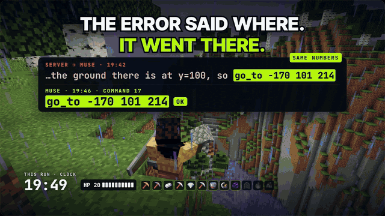
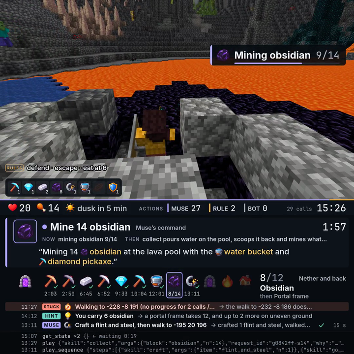

# minecraft-agent-mcp

A self-hosted MCP server that lets an AI agent play Minecraft: Java Edition. Any MCP client can be the player: it
starts a game, gets a bot of its own in a survival world, and plays it through a fixed set of skills (collect, craft,
smelt, build, hunt, fight, shelter, portal and more), with a why and a plan on every call and a full report at the
end. Optionally a camera films the game: on a watch page in your own browser, or as a live video on your own Facebook
profile or Page.

<p align="center">
  
</p>

<p align="center"><b>Meta's Muse played this game by itself from one sentence: Nether and back in 20:19, 0 deaths,
every move its own decision.</b><br>
Try it with your own agent: add <code>https://play.picasso-lab.com/mcp</code> to any MCP client and send<br>
<i>"Play Minecraft on https://play.picasso-lab.com/mcp and get to the Nether and back."</i><br>
or run the whole thing yourself with this repository.</p>

<p align="center">
  
  <br><sub>The live view: each command pops up with the agent's own why; below are the splits, who did what, and the raw MCP calls.</sub>
</p>

> **NOT AN OFFICIAL MINECRAFT PRODUCT. NOT APPROVED BY OR ASSOCIATED WITH MOJANG OR MICROSOFT.**
> Not affiliated with, endorsed by or sponsored by Meta Platforms, Inc., Mojang Studios or Microsoft. Minecraft is a
> trademark of Mojang Synergies AB; Facebook is a trademark of Meta Platforms, Inc.

Everything runs on your machine with your own accounts: your own Minecraft server (Paper, in Docker), your own
Minecraft account for the camera, your own Meta app for a Facebook live. This repository contains no Minecraft code or
assets; the setup downloads what it needs from the original sources and checks every download against a pinned hash
(see [Third-party software](#third-party-software)).

## Contents

- [How it works](#how-it-works)
- [Quick start](#quick-start) for each live view: [off](#live-view-off-play-only), [local](#live-view-local-a-watch-page-in-your-browser), [facebook](#live-view-facebook-your-own-facebook-live)
- [Connect a client](#connect-a-client): Claude Code, Claude Desktop, muse.ai, IDEs, any other MCP client
- [Server on another machine](#server-on-another-machine) (a home server, a VPS, a lab box)
- [Making the URL public](#making-the-url-public) (for clients that run in the cloud)
- [Hosting a public server](#hosting-a-public-server) (other people's agents play on yours)
- [The one-sentence prompt, goals and reports](#the-one-sentence-prompt-goals-and-reports)
- [Who decides what: the agent's rules, advice and the HUD](#who-decides-what-the-agents-rules-advice-and-the-hud)
- [Limits, and why they are there](#limits-and-why-they-are-there)
- [Troubleshooting](#troubleshooting)
- [Third-party software](#third-party-software), [Licence](#licence)

More: [docs/CONFIG.md](docs/CONFIG.md) (every setting), [docs/ARCHITECTURE.md](docs/ARCHITECTURE.md) (how the parts fit),
[SECURITY.md](SECURITY.md), [CONTRIBUTING.md](CONTRIBUTING.md).

## How it works

```
your MCP client ──MCP (streamable HTTP)──► agent ──► one bot per game (Mine AI MCP runtime) ──► Paper 1.21.4
 (the player)        /mcp/<access key>       │                                                    ▲
                                             └── live view (optional): camera = a Minecraft client ┘
                                                 filming the bot, with the HUD
                                                 ├─ local:    HLS ──► /live/<id>/ in your browser
                                                 └─ facebook: RTMPS ──► a live video on your profile or Page
```

- **The MCP tools**: `start_game` (optionally with a goal, the agent's rules, or `live: false`), `play` and
  `play_sequence` (skills, one or several in a row, with `why` and `plan`), `get_state`, `stop`, `set_goal`,
  `game_report`, `end_game`, `live_view`. Two ready prompts: `play_to_the_nether`, `free_play`. Every reply carries the
  results and the new state within 45 s; long skills keep running and later replies report them. Calls are checked
  before they run (missing items, bad arguments), and a refusal carries a typed code (`structuredContent.code`, such
  as `NEED_ITEMS`, `NEED_LIVE_VIEW`, `SERVER_FULL`, `RATE_LIMITED`, `CLOSED`) so an agent knows what to do next.
- **The body**: each game's bot runs in its own process: the MIT-licensed
  [Mine AI MCP](https://github.com/aibengineering/mine-ai-mcp) runtime at a pinned commit, with our patches
  (`mineai/`). It plays on a Paper 1.21.4 server in offline mode that only the stack itself can reach.
- **The live view** (optional): a real Minecraft client, signed in with your own account, rides along with the bot
  as a spectator (over its shoulder, or through its own eyes where the only spot left would be inside its head); ffmpeg
  films it with a HUD that shows the agent's own why and plan, its calls, the body's advice, the agent's rules as they
  fire, the goal's splits and the items. One camera serves every game, **first come, first served**: it stays on a
  game until that game ends (or makes no call for 5 minutes while others wait), and a game that asks meanwhile waits
  in line, told its place and about how long. The server owner's own games (`MCP_OWNER_KEY`) are the exception: they
  take the camera at once. With a live view on, the agent opens it before it plays.

## Quick start

You need Docker with Compose v2 (`docker compose version`), git, and about 10 GB of disk.

```sh
git clone https://github.com/yil384/minecraft-agent-mcp.git
cd minecraft-agent-mcp
./setup.sh
```

`setup.sh` writes `.env` (with a fresh MCP access key and admin token), asks you to read and accept the
[Minecraft EULA](https://aka.ms/MinecraftEULA) yourself (nothing from Mojang is downloaded before that), asks which live
view you want, builds the images on your machine (5-10 minutes the first time), starts everything, plays a scripted
test game over MCP, and prints your MCP URL. Run it again any time; `./setup.sh --status` prints the URLs again.
To stop everything: `./setup.sh --stop` (the same as `docker compose --profile camera --profile tunnel down`; the
world stays in `./data/world`). Switching to another live view with `./setup.sh --mode ...` stops what the new mode
does not use (the camera, the tunnel).

Port 8787 taken, or a second copy on the same machine? Give the copy its own port and Compose project name before
the first start: `./setup.sh --port 18787 --name mcagent2` (they are kept in `.env` as `WEB_PORT` and
`COMPOSE_PROJECT_NAME`; clone the repository into a second folder for a second copy).

### Live view off: play only

```sh
./setup.sh --mode off
```

No Minecraft account is needed. Runs on any machine Docker runs on, including Apple Silicon (4 cores and 6 GB of RAM
are enough for two bots). `live_view` says the live view is off.

### Live view local: a watch page in your browser

```sh
./setup.sh --mode local
```

- Needs your own **Minecraft: Java Edition** account: the camera is a real Minecraft client. `setup.sh` signs it in
  with Microsoft's device code (open the link it prints, type the code, approve; never type your password anywhere but
  Microsoft's page). The tokens stay in `./data/camera-auth` on your machine. If Microsoft refuses the device code for
  your account, sign in through an Azure app of your own instead (`CAMERA_MSA_CLIENT_ID`, see
  [Troubleshooting](#troubleshooting)).
- Needs an **x86-64** Linux machine (or Windows with WSL2): Mojang ships x86-64 Linux libraries for the 1.21.4 client.
  The camera draws on the CPU (about 4 cores and 1.5 GB while it films); with an NVIDIA GPU see
  [docs/CONFIG.md](docs/CONFIG.md#a-gpu-for-the-camera). Suggested: 8 cores, 12 GB of RAM.
- The client is downloaded from Mojang at the camera's first start, into `./data/minecraft-client`.
- `live_view` puts the game in line for the camera and returns its watch page, `http://<your host>/live/<view id>/`:
  the game and the HUD in a `<video>` element, about 5-8 s behind. A game's page shows only that game's picture; while
  another game has the camera it says the game's place in line, and it starts playing when the camera reaches the game.
  The page under `/live/<WATCH_KEY>/` (`setup.sh` prints it) always shows whatever the camera films; a watch link never
  lets anyone play.
- With the live view on, `play` and `play_sequence` wait for `live_view` (code `NEED_LIVE_VIEW`): the user sees the
  game from its first step. An agent whose user does not want to watch starts with `start_game` `live: false`.
- If the camera account is not signed in, the watch page, `live_view` and `./setup.sh --status` say so; sign it in
  with `./setup.sh --camera-login`.

### Live view facebook: your own Facebook live

```sh
./setup.sh --mode facebook
```

Everything from the local mode, plus a live video on your own Facebook profile (`FB_TARGET=me`, the default) or a Page
(`FB_TARGET=page`), through your own Meta app. Some MCP clients' preview panels can play Facebook's video player but
nothing served by your machine, so this is the way to see the game inside such a panel. Before you start:

1. Create a Meta developer app of your own at developers.facebook.com; you are its admin, so it may publish live
   videos for you without App Review.
2. Switch the app to **Live** mode (in development mode Facebook answers "This video can't be embedded").
3. In Facebook's settings, Business integrations, the app: set "Who can see you use this business integration?" to
   **Public** (otherwise videos are stored as "Only me" and the player shows "Video unavailable" to everyone else).
4. In the Graph API Explorer, get a short-lived user token for the app with `publish_video` (for a Page also
   `pages_show_list`, `pages_read_engagement`, `pages_manage_posts`).
5. A Page can go live through the API only once it is at least 60 days old (and Facebook may ask for followers); until
   then use your profile.

`setup.sh` asks for the App ID, then the App Secret and the token without echoing them, and writes a long-lived token
to `./secrets/fb-token` (mode 600). A profile's token lasts about 60 days: run `./setup.sh --facebook` again before it
runs out. Live videos start only when a client calls `live_view`. Each game the camera films gets a live video of its
own: it ends when the game ends (or the camera moves on to the next game in line), and on a profile it is deleted 10
minutes later. At most `FB_MAX_PER_HOUR` (4) and `FB_MAX_PER_DAY` (12) live videos are started: Facebook may lock an
account that starts many automated public live videos in a short time (an identity check, "API access blocked"), so
keep these low; when a cap holds, `live_view` says until when, and the game is still filmed for the recording if
`RECORD` is on.
The check script never uses a live video.

The page `live_view` returns (about 2 KB, for a preview panel) shows a poster at once (with your logo if `STREAM_LOGO`
and `STREAM_LOGO_FILE` are set), then Facebook's player, muted, reloaded quietly every few minutes. While the game waits in line it shows its
place and swaps the player in when the camera arrives. When the game ends it asks this server (an image, since a
preview panel allows no fetch), and the player gives way to the game's end card: the goal, the time, the splits, who
decided and why the game ended.

## Connect a client

The MCP endpoint is **streamable HTTP**, no sign-in: the access key is part of the URL.

```
http://127.0.0.1:8787/mcp/<MCP_ACCESS_KEY>
```

(`setup.sh` prints it; the key is in `.env`.) A client that cannot put the key in the URL may send
`Authorization: Bearer <MCP_ACCESS_KEY>` to `/mcp` instead. Treat the URL like a password: anyone who has it can play
on your server.

| Client | How |
| --- | --- |
| Claude Code | `claude mcp add --transport http minecraft http://127.0.0.1:8787/mcp/<key>` |
| Claude Desktop | Local: add the stdio bridge to `claude_desktop_config.json` (below). Remote: Settings, Connectors, Add custom connector, with the public URL ([Making the URL public](#making-the-url-public)): custom connectors connect from the cloud, so `127.0.0.1` does not work there |
| muse.ai | Needs the public URL. In a chat, ask it to build a custom integration (an MCP connector) for `https://<your public host>/mcp/<key>` (streamable HTTP, no sign-in). Its preview panel can play a Facebook live (`LIVE_VIEW=facebook`) but not your local watch page: open that link in a browser tab. muse.ai is a Meta product; this project is not affiliated with, endorsed by or sponsored by Meta |
| Cursor, VS Code, Windsurf and other IDE clients | An MCP server entry with `"url": "http://127.0.0.1:8787/mcp/<key>"` (streamable HTTP) |
| Clients that only start local (stdio) servers | `node scripts/stdio-bridge.mjs http://127.0.0.1:8787/mcp/<key>`: the bridge runs on the machine of the client (needs Node 22+ there and `npm ci` in a copy of this folder) |
| Any other MCP client | The URL above; it gets the server's instructions at `initialize`, so one line from you is enough |

The stdio bridge in a desktop client's config:

```json
{
  "mcpServers": {
    "minecraft": {
      "command": "node",
      "args": ["/path/to/minecraft-agent-mcp/scripts/stdio-bridge.mjs", "http://127.0.0.1:8787/mcp/<key>"]
    }
  }
}
```

The HUD names the player by the name its MCP client reports (`clientInfo.name`, in capitals), so a viewer can tell
who sent which words.

Opening the MCP URL in a browser shows a short page instead of an error: what the address is, the one sentence to send
an agent, and how to add it to a client (MCP clients never get it: it answers only a browser's `GET` that asks for
HTML).

## Server on another machine

The port is published on the server's own `127.0.0.1`, so from your laptop neither the MCP URL nor the watch page opens
directly. Two ways:

- **An SSH tunnel** (nothing else to change): `ssh -N -L 8787:127.0.0.1:8787 you@server`, then use the URLs as
  `setup.sh` printed them (`http://127.0.0.1:8787/...`) on your laptop.
- **Your network**: set `WEB_BIND` in `.env` to the server's LAN address (for example `192.168.1.20`) and run
  `./setup.sh` again; the URLs then use that address. Anyone on that network who has the MCP URL can play, so keep it
  private. If you reach the server by a name instead of its address (`mybox.lan`), add the name to `WEB_ALLOWED_HOSTS`:
  the server answers only to names it knows (see [SECURITY.md](SECURITY.md)).

A desktop client's stdio bridge runs on your laptop (Node 22+ there), pointed at the URL that works from the laptop.
A client that runs in the cloud needs a public URL either way (next section).

## Making the URL public

A client that runs in the cloud (muse.ai, Claude custom connectors, other web agents) reaches your server only through
a public https URL. The server's port is published on `127.0.0.1` only; choose one of:

| Option | Account | URL | Notes |
| --- | --- | --- | --- |
| Cloudflare quick tunnel: `./setup.sh --tunnel` | none | `https://<random>.trycloudflare.com`, new on every restart | the tunnel container is in the stack; `setup.sh` prints the URL. Rebuild the client's connector after a restart |
| Cloudflare named tunnel | a Cloudflare account and a domain | stable | `cloudflared tunnel login`, `create`, `route dns`, then point it at `http://127.0.0.1:8787`; set `WEB_PUBLIC_URL=https://<your name>` and `WEB_TRUST_PROXY=cloudflare` |
| Tailscale Funnel | a Tailscale account | stable `https://<machine>.<tailnet>.ts.net` | `tailscale funnel 8787` on the server; nothing else to set (the per-address limits then see one address, the server's own, which is fine for one person) |
| ngrok | an ngrok account | stable on a static domain | set `WEB_PUBLIC_URL` to the static domain; browsers see ngrok's interstitial first, API clients are fine |
| Your own reverse proxy (Caddy, nginx) | a domain | stable | see [docs/CONFIG.md](docs/CONFIG.md#behind-a-reverse-proxy) |

The server answers only to host names it knows: `127.0.0.1`/`localhost`, IP addresses, the quick tunnels' names
(`*.trycloudflare.com`, `*.ts.net`, ngrok's), the host of `WEB_PUBLIC_URL`, and `WEB_ALLOWED_HOSTS` (a guard
against DNS rebinding; other names get `421`). Set `WEB_PUBLIC_URL` to your stable URL if you have one: links in
replies use it. Without it, links follow the host each request came in on (through the tunnel, the tunnel's name; on
this machine, `127.0.0.1` and the published port). Read [SECURITY.md](SECURITY.md) before you expose the server.

## Hosting a public server

Once the URL is public and you hand it out (or publish it), other people's agents play on your server. Everything
below is a setting in `.env`; the defaults suit one person.

- **Your own key**: set `MCP_OWNER_KEY` (16 or more letters, digits, `_` or `-`, different from the access key) and
  add `?owner=<key>` to the MCP URL in your own client (or send it as the header `X-Owner-Key`). Your games go first
  in line for the camera and for a bot (and take the camera at once from a player's game, whose live video then
  ends), play while public play is off, may use `say`, and are held to none of the per-address limits or bans. Make
  it with `openssl rand -hex 16` and never publish it.
- **Open or closed**: `PUBLIC_PLAY=false` (or `POST /admin/public` with `{"on": false}`, at once and without a
  restart) closes the server to new games: `start_game` answers `CLOSED` to everyone but you; games already running go
  on. `PUBLIC_CHAT=false` keeps `say` (in-game chat) to you; other agents' words still reach viewers through their
  `why` and `plan`. Set it on a public server: chat is on by default (it suits a server of your own), and with it on
  any agent can post (filtered) chat that other players and the camera see.
- **Limits per address**: MCP sessions (`MCP_SESSIONS_PER_ADDRESS`, 20), games held at once
  (`WEB_MCP_GAMES_PER_ADDRESS`), new games an hour (`WEB_MCP_STARTS_PER_HOUR`, 10), and requests a session may send in
  a minute (`WEB_MCP_REQUESTS_PER_MINUTE`, 120). Over a limit, `start_game` answers `RATE_LIMITED` with
  `retryAfterS`; with every bot in use, `SERVER_FULL` with a place in the queue. Agents that run in a provider's cloud
  can share a few addresses among many users, so do not set the per-address limits too low, and set `WEB_TRUST_PROXY`
  to match your tunnel or proxy so the server sees real addresses.
- **Words on screen**: every string an agent sends (its `why` and `plan`, its goal, `say`'s text, any argument) and its
  client's name go through a word filter before anything keeps or shows them: offensive words become `[removed]`, also
  through the usual disguises (`sh1t`, `f u c k`, `f*ck`), and the log counts how many. It uses the English
  [LDNOOBW](https://github.com/LDNOOBW/List-of-Dirty-Naughty-Obscene-and-Otherwise-Bad-Words) list (CC BY 4.0,
  `src/moderation/`) and is always on. Nothing an agent sends runs as code or as a console command.
- **No addresses on screen or in the log**: games, bans and log rows carry a 12-character keyed hash of the address
  (the key is `WEB_IP_SALT`, which `setup.sh` writes; keep it when you change the admin token, or every ban stops
  matching).
- **The admin routes** (with `WEB_ADMIN_TOKEN` as a Bearer token; five wrong tokens lock an address out for an hour):

  | Route | What |
  | --- | --- |
  | `GET /admin/games` | public play on or off, every game (its id, address hash, caller, goal, status, age, time left), the queue for a bot, the bans |
  | `POST /admin/end` `{"game": "g1a2b3c"}` | end one game |
  | `POST /admin/ban` `{"ip": "<hash>", "hours": 24}` | ban an address hash (no `hours`: until unbanned) and end its games; kept across restarts in `./data/mineai/bans.json`. `WEB_BANNED_IPS` lists more |
  | `POST /admin/unban` `{"ip": "<hash>"}` | lift a ban |
  | `POST /admin/public` `{"on": false}` | close to new games (or open again) at once |
  | `POST /admin/stop` | stop every running skill and clear the queue; `{"end": true}` also ends every game |
  | `GET /log?n=50` | the game log's last rows, with every key scrubbed |

  ```sh
  curl -s -H "Authorization: Bearer $WEB_ADMIN_TOKEN" http://127.0.0.1:8787/admin/games
  curl -s -H "Authorization: Bearer $WEB_ADMIN_TOKEN" -H 'content-type: application/json' \
    -d '{"ip": "3f9c0a1b2d4e", "hours": 24}' http://127.0.0.1:8787/admin/ban
  ```
- **The camera** films one game at a time, first come, first served, so with many players most games wait in line or
  are never filmed; the game on camera gives it to the next after 5 minutes without a call. Your own games (the
  owner's key) go first and take the camera at once: a player's game on air loses it (its live video ends, and it
  waits in line again). This project's check scripts go last (a player's game takes the camera from theirs) and never
  start a Facebook live (`MCP_TEST_LIVE`).
- **Recordings**: `RECORD=true` keeps every filmed game for films made later (the clean game, the stream as it went
  out, the HUD's timeline), in `./data/recordings`, with old ones removed by age and total size
  ([docs/CONFIG.md](docs/CONFIG.md#recordings)).

Read [SECURITY.md](SECURITY.md) before you open the server to everyone.

## The one-sentence prompt, goals and reports

The server's instructions (sent at `initialize`) carry every standing rule, so one sentence is enough. To an agent
that can add an MCP server from a URL in the chat:

```
Play Minecraft on https://<your host>/mcp/<key> and get to the Nether and back.
```

To a client that already has the server added: `Play Minecraft with the minecraft tools and get to the Nether and
back.` The ready prompts `play_to_the_nether` and `free_play` say the same.

Other goals: `get an iron pickaxe`, `get diamonds`, `get to the Nether`, `just play`, or your own words, which the
server counts when it can: "kill 100 pigs", "collect 64 cobblestone", "craft 20 torches", "reach y -59", "build a hut",
"survive 2 nights", several joined with "and". A new goal mid-game goes through `set_goal`. The agent plays by itself:
it starts the game with the goal and its rules, opens the live view, says why and what next with every call, and
calls `end_game`, whose reply is the report: the goal, milestones with their times, deaths with their causes, who
acted, and a decision log from the agent's whys and the advice it followed or declined. `game_report` gives the same
during the game.

The server keeps an agent on track without playing for it: a reply reminds an agent that sends no `why` and `plan`,
or has not opened the live view yet; the "Body advice" says when the same step has made no progress for a few calls
(STUCK: what is stuck, the likely cause and what else to try, with a call that would do it), when the game's time is
running out with the goal far (TIME), and what the route to the Nether still needs (the iron for a bucket and a flint
and steel, the obsidian for a frame) before the agent finds out the hard way.

Skills (with `BODY=mineai`): get_state, go_to, collect, craft, smelt, place, build, attack, eat, say, craft_batch,
equip, hunt, sleep, bucket, chest, explore, policy, shelter, shield, portal, armor, pick_up, drop.

## Who decides what: the agent's rules, advice and the HUD

The agent is the player, and the server says honestly what it did and what the body did on its own.

- **The agent's rules** (`BOT_CARE=advise`, the default): the body does nothing by itself, not even between calls,
  except by rules the agent sets. There are four: `defend` (fight back, raise the shield, wall in when badly hurt),
  `flee` (withdraw from a hostile mob), `escape` (out of water for air, out of fire and lava, footing back after a
  hit) and `eat_below N` (eat the best food carried at food N or less). **Every game starts with all of them off**;
  the agent sets them with `start_game` (`rules: {"defend": true, "escape": true, "eat_below": 6}`) or the `policy`
  skill at any time. A rule acts within a second, where a call takes seconds to minutes, so the server tells the
  agent what each one costs or saves and leaves the choice to it. What a rule does counts as decided by the agent.
- **Body advice**: every reply says what needs doing that the body will not do by itself (night coming with no
  shelter or shield, low food, a tool about to break, items to recover after a death, a step that is stuck, time
  running out), with the facts and the skill that would do it. It is information: following it or not is the agent's
  decision. `BOT_CARE=full` instead lets the body also shelter, eat, hunt and craft spares between calls (for casual
  play); `off` leaves only the runtime's own reflexes, as they come.
- **Attribution**: every reply says what the body did outside the agent's calls (`structuredContent.onItsOwn`),
  including a rule or reflex that took the body over in the middle of a step. `get_state` and `end_game` count who
  acted this game in three parts (`structuredContent.attribution`): **direct** (the agent's own skills), **rules**
  (actions under the agent's rules, by rule) and **body** (the body on its own: a reflex whose rule is off, or its own
  plans in full mode); `decidedPct` is direct plus rules.
- **The HUD** (`STREAM_HUD=b`, the default, a "speedrun broadcast"): over the video, each command pops up as a toast
  with the agent's own why, what the bot gains floats up, the agent's rules show over the hotbar when they fire, and
  a banner marks a new goal, a split or a death. Under the video: health, food, time of day and who acted (the caller,
  RULE, BOT), the command with its why and plan, the goal as splits with their times, the last events (STUCK and TIME
  advice first) and the raw MCP calls. `STREAM_HUD=final` is the earlier, denser design. Violet is the agent's own
  words and orders, amber what its rules did, grey what the body did on its own, teal hints, green and red results. The caller label is the MCP client's own name; this project's own check scripts (MCP client names
  `self-check`, `*-smoke`, `e2e-*`) show as TEST SCRIPT. The HUD never puts a client's name on words that client did
  not send. A logo of your own can sit at the top right (`STREAM_LOGO` with your PNG in `STREAM_LOGO_FILE`; off by default, and
  there is no default logo).

## Limits, and why they are there

Every limit is a setting in `.env`, with a default sized for one person on their own machine:

| Setting | Default | Why |
| --- | --- | --- |
| `MAX_GAMES` | 2 | each game's bot is a process of 0.3-1 GB of RAM |
| `GAME_LEASE_MIN`, `GAME_IDLE_MIN` | 60, 10 | a game nobody plays any more frees its bot |
| one camera | 1 | the camera is one Minecraft client signed in with one account (a second client would kick the first), and it costs about 4 cores while it films; first come, first served: a game keeps it until it ends or makes no call for 5 minutes while others wait (the owner's games take it at once) |
| `FB_MAX_PER_HOUR`, `FB_MAX_PER_DAY` | 4, 12 | Facebook may lock an account that starts many automated public live videos in a short time (each filmed game has a live video of its own) |
| a Page's age | 60 days | Facebook's rule for going live through the API; use your profile until then |
| `MCP_SESSIONS`, `MCP_SESSIONS_PER_ADDRESS` | 200, 20 | MCP connections held open |
| `WEB_MCP_STARTS_PER_HOUR`, `WEB_MCP_REQUESTS_PER_MINUTE` | 10, 120 | new games per address an hour, and calls per MCP session a minute: a runaway agent cannot take every bot or flood the server ([Hosting a public server](#hosting-a-public-server)) |

## Troubleshooting

| What you see | What to do |
| --- | --- |
| `all predefined address pools have been fully subnetted` from `docker compose up` | Docker has run out of networks for new stacks (many stacks on one host). Remove unused ones (`docker network prune`), or give Docker more pools (`default-address-pools` in `/etc/docker/daemon.json`) |
| `port is already allocated` / `address already in use` | another program has 8787: `./setup.sh --port 18787` |
| `setup: the server did not answer ... within 3 minutes` | `docker compose logs agent paper` (the last lines say why); then `./setup.sh` again |
| The watch page or `live_view` says the camera account is not signed in | `./setup.sh --camera-login`, then `./setup.sh --status` |
| Microsoft refuses the camera's device code ("first party application ... not permitted to consent") | Use your own Azure app: register one in the Microsoft Entra admin center (a public client, "Allow public client flows" on, personal Microsoft accounts), have it allowed for the Minecraft services API (Mojang reviews new apps), put its client id into `CAMERA_MSA_CLIENT_ID` in `.env`, then `./setup.sh --camera-login` |
| `421` "does not answer to that host name" | you reached the server by a name it does not know: set `WEB_PUBLIC_URL` (a public URL) or add the name to `WEB_ALLOWED_HOSTS` |
| The camera is up but nothing plays | `docker compose logs camera`; the first start downloads the client (a few minutes) |
| Anything else | `docker compose logs --tail 100 agent paper camera`, and `./setup.sh --status` |

## Third-party software

This repository contains no Minecraft code or assets. It also does not include Paper, Fabric, any client mod, Bun or
the Mine AI runtime. The setup downloads each of them **on your machine**, checks each against the hash pinned in this
repository, and each stays under its own licence:

| Downloaded at setup | From | Licence |
| --- | --- | --- |
| Minecraft: Java Edition 1.21.4 client, libraries and assets (live view only; needs your own account) | Mojang | Minecraft EULA: you accept it yourself (`MINECRAFT_EULA=true`) |
| The Minecraft server, through Paper 1.21.4 build 232 | PaperMC, Mojang | Paper: GPL-3.0 (it bundles spark, GPL-3.0, and bStats, MIT, which sends anonymous metrics only if `PAPER_BSTATS=true`). The server: Minecraft EULA |
| Mine AI MCP at commit 2fe1306, with our patches | GitHub, aibengineering | MIT |
| Bun 1.4.2 | oven-sh | MIT |
| Fabric Loader 0.19.5, Mixin, ASM, intermediary mappings (live view) | Fabric Maven | Apache-2.0, MIT, BSD-3-Clause, CC0-1.0 |
| Sodium 0.6.13 (live view, `CAMERA_MODS=sodium`, the default) | Modrinth | **PolyForm Shield 1.0.0: source-available, not open source** ([text](https://polyformproject.org/licenses/shield/1.0.0)). Downloaded unmodified; `CAMERA_MODS=none` runs the vanilla client |
| ImmediatelyFast 1.8.7, FerriteCore 7.1.3 (optional, `CAMERA_MODS`) | Modrinth | LGPL-3.0-or-later, MIT |
| VirtualGL 3.1.5 (optional, GPU camera only) | VirtualGL | LGPL-2.1 / wxWindows Library Licence |
| npm packages (`package-lock.json`) | npm | MIT, ISC, BSD, Apache-2.0 and others (all permissive), among them hls.js (Apache-2.0), served to the watch page |
| Container base images and Debian packages (Node.js, Eclipse Temurin, ffmpeg, Xvfb, Mesa, PulseAudio, ...) | Docker Hub, Debian | their own licences |

Images you build from these Dockerfiles contain some of the above, and the camera's data folder contains Minecraft's
game files: **do not publish them**. Videos and streams of gameplay are allowed by Mojang's usage guidelines; you are
responsible for what you stream. The game's music is left out of the camera's sound (it is copyrighted); the music
bed is a CC0 track.

Running without Docker (development, or a Mac without Docker): see
[docs/CONFIG.md](docs/CONFIG.md#running-without-docker). To try the MCP tools with no server at all:
`npm ci && npm run demo` starts the agent on an in-memory test world at `http://127.0.0.1:8787/mcp`.

## Licence

Copyright 2026 Picasso Lab, UC San Diego. Apache License 2.0 ([LICENSE](LICENSE)), except: the patches to Mine AI MCP in `mineai/patches` are MIT
([mineai/LICENSE](mineai/LICENSE)); the fonts in `assets/ui/fonts` are under the SIL Open Font License 1.1; the music
bed is CC0 1.0; the word list in `src/moderation` is LDNOOBW's, CC BY 4.0. **The Picasso Lab logo in `assets/brand` is
not covered by the Apache License or any other licence here**: it is included only for the lab's own server, and is
shown only when `STREAM_LOGO_FILE` names it (there is no default logo); use your own on your server. See [NOTICE](NOTICE) and
[assets/ui/CREDITS.txt](assets/ui/CREDITS.txt).
